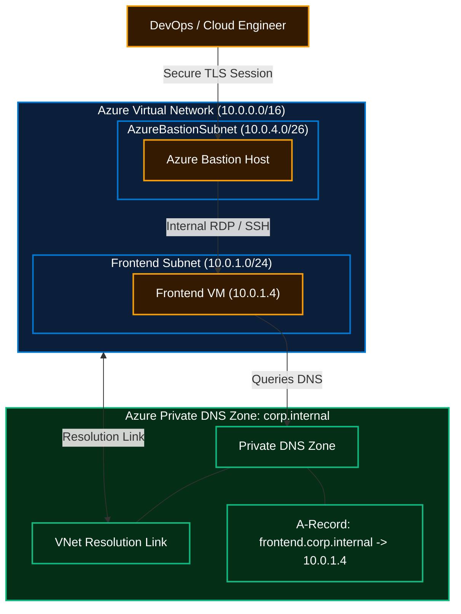

# Azure Private DNS Zones & Secure Infrastructure with Terraform

Production-ready, modular Terraform architecture for provisioning **Microsoft Azure Private DNS Zones**, Virtual Network Links, private A-records, **Azure Bastion** jump hosts, and multi-environment **Azure DevOps (ADO)** CI/CD pipelines.

---

## 🏛️ Architecture Overview

In an enterprise cloud landing zone, workloads inside private virtual networks should never be exposed directly to the public internet. This repository automates the end-to-end setup of internal name resolution using **Azure Private DNS Zones** alongside **Azure Bastion** for zero-trust administration.



---

## ✨ Key Capabilities

* 🌐 **Azure Private DNS Zones:** Provisioned with `for_each` loops to manage multiple private internal domains (e.g., `corp.internal`).
* 🔗 **Virtual Network Links:** Automatically links private DNS zones to VNets with optional registration/resolution enabled.
* 📍 **Automated A-Records:** Dynamically maps VM network interface private IPs to friendly DNS names (`frontend.corp.internal`).
* 🛡️ **Zero-Public-IP Bastion:** Deploys an Azure Bastion Host inside `AzureBastionSubnet` with dedicated Public IP for secure administrative access without exposing VM ports.
* 🏗️ **Modular IaC Design:** Clean separation of concerns with reusable modules under `modules/` consumed by distinct `environments/` (`preprod` and `prod`).
* 🔄 **Multi-Stage ADO CI/CD:** Azure DevOps YAML pipeline supporting parameterized runs, environment selection, and integrated security scanners (**TfSec, Checkov, Trivy, TruffleHog**).

---

## 📁 Repository Structure

```text
azure-private-dns-infrastructure-automation/
├── azure-pipelines.yml                       # Multi-stage Azure DevOps YAML pipeline
├── LandingZone_Infra_VariablesParameters.yml # Parameterized pipeline definition
├── environments/
│   ├── preprod/                             # Pre-production environment deployment
│   │   ├── main.tf                          # Preprod module invocations
│   │   ├── variables.tf                     # Preprod variable schemas
│   │   ├── terraform.tfvars                 # Preprod values & DNS zone definitions
│   │   ├── provider.tf                      # AzureRM provider & remote backend
│   │   └── outputs.tf                       # Preprod outputs
│   └── prod/                                # Production environment deployment
│       ├── main.tf                          # Prod module invocations
│       ├── variables.tf                     # Prod variable schemas
│       ├── terraform.tfvars                 # Prod values & DNS zone definitions
│       └── provider.tf                      # Prod provider & backend
└── modules/
    ├── DNS_Zone/                            # Private DNS Zone, VNet Link & A-Records
    ├── azurerm_bastion/                     # Azure Bastion Host deployment
    ├── azurerm_key_vault/                   # Key Vault and secret management
    ├── azurerm_public_ip/                    # Standard Public IP for Bastion
    ├── azurerm_resource_group/              # Resource Group lifecycle
    ├── azurerm_subnet/                      # Subnets with optional delegation
    ├── azurerm_virtual_machine/             # Linux virtual machines and NICs
    ├── azurerm_virtual_network/             # VNet address spaces & peering
    └── windows_vm/                          # Windows Server VM deployment
```

---

## 🚀 Quickstart & Local Deployment

### 1. Prerequisites
- **Terraform:** `>= 1.0.0`
- **Azure CLI:** `>= 2.50.0`
- Active Azure Subscription with permissions to create Network and Compute resources.

### 2. Login to Azure
```bash
az login
az account set --subscription "<YOUR_SUBSCRIPTION_ID>"
```

### 3. Deploy Pre-Production Environment
```bash
cd environments/preprod

# Initialize Terraform (fetches modules and providers)
terraform init

# Validate configuration syntax
terraform validate

# Review proposed changes
terraform plan

# Apply infrastructure changes
terraform apply -auto-approve
```

---

## 🔍 Verification & Testing

Once deployment completes:
1. Navigate to the Azure Portal ➔ **Virtual Networks** ➔ Verify `vnet-dev` and subnets are active.
2. Go to **Private DNS Zones** ➔ Select `corp.internal` ➔ Verify:
   - **Virtual network links:** Shows `zone1-vnet-link` linked to `vnet-dev`.
   - **Recordsets:** Shows an `A` record for `frontend` pointing to the private IP (e.g. `10.0.1.4`).
3. Connect to the VM via **Azure Bastion**:
   - In Azure Portal, select `frontend-vm-1-dev` ➔ Click **Connect** ➔ Choose **Bastion**.
   - Authenticate with the VM credentials.
4. Test internal DNS resolution from the terminal:
   ```bash
   nslookup frontend.corp.internal
   ping frontend.corp.internal
   ```

---

## 🧹 Cleanup & Teardown

To prevent unnecessary cloud spend when done testing:
```bash
cd environments/preprod
terraform destroy -auto-approve
```

---

## 👤 Author

**Sujeet Kumar**  
Senior Azure & DevOps Engineer (17+ Years IT Experience)  
- [GitHub Profile](https://github.com/Sujeetkumar122)
- [LinkedIn Profile](https://linkedin.com/in/sujeetkumar122)
